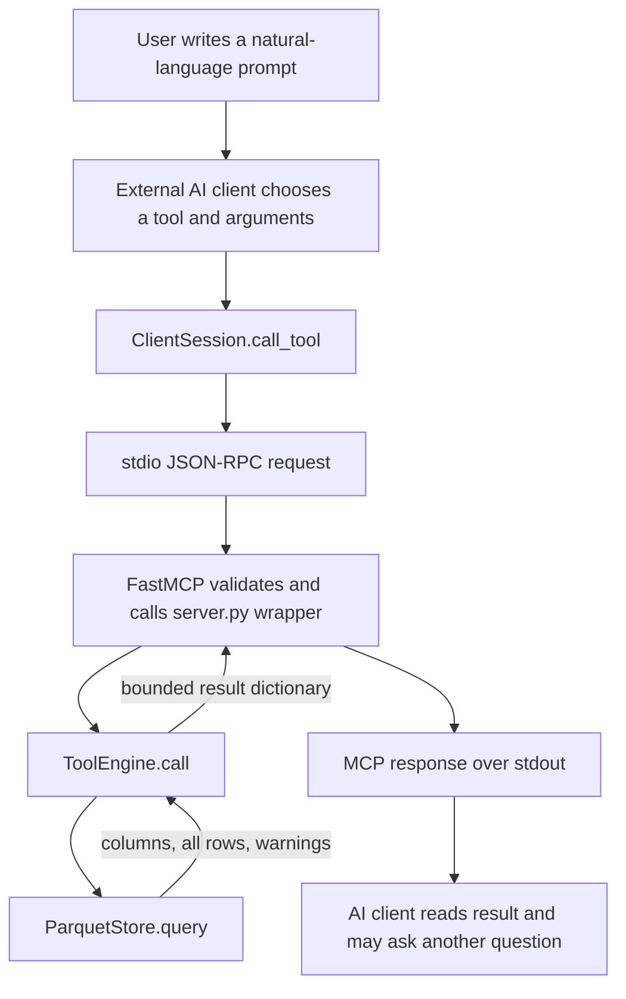

# Telemetry: complete function and data-flow walkthrough

Read the two example maps first. Each arrow means **the output on that arrow becomes an input to the next function**. Indented functions are called inside the function above them.

These are actual runs against the dataset open in the IDE, using the installed MCP SDK and a real client/server stdio connection. The natural-language prompts below illustrate how an AI client could choose the requests; no model was called to choose them.

| Example | Prompt                                                                             | Executed tool  | Actual result                                                  |
| ------- | ---------------------------------------------------------------------------------- | -------------- | -------------------------------------------------------------- |
| 1       | Show frontend p95 latency from 14:00 to 14:05; return two rows.                    | `query_metric` | Six logical rows; first two returned; summary p95 = 120 ms.    |
| 2       | Show email ERROR logs containing “timed out” from 14:00 to 14:10; return two rows. | `search_logs`  | Five matches; L1 and L2 returned; next page returns L3 and L4. |

All times in the examples are **2026-03-14, UTC**, matching the fixture. A window includes its start and excludes its end.

## Open the detailed records

| Record                                                                                                | What it contains                                                                         |
| ----------------------------------------------------------------------------------------------------- | ---------------------------------------------------------------------------------------- |
| [Example 1: every captured application/SDK stage](tooling/call-walkthrough/query_metric-1-details.md) | Expandable function entries with inputs, closure values, outputs, file and line.         |
| [Example 2: every captured application/SDK stage](tooling/call-walkthrough/search_logs-1-details.md)  | The same detail for the log search.                                                      |
| [Example 2: next page](tooling/call-walkthrough/search_logs-2-details.md)                             | The additional cursor-validation path.                                                   |
| [Exact requests and responses](tooling/call-walkthrough/requests-and-results.json)                    | All request arguments, result dictionaries and client-visible MCP results.               |
| [Example 1: raw call events](tooling/call-walkthrough/query_metric-1-calls.txt)                       | Every Python and C/builtin call event observed inside the server's `tools/call` handler. |
| [Example 2: raw call events](tooling/call-walkthrough/search_logs-1-calls.txt)                        | The same raw trace for logs.                                                             |
| [Next page: raw call events](tooling/call-walkthrough/search_logs-2-calls.txt)                        | The same raw trace with a continuation cursor.                                           |

The readable maps group repeated operations. The raw files retain them, including generator-expression resumptions, JSON serialization, schema checking and builtin calls. Call numbers in the detail files match the raw files.

**Trace boundary:** runtime capture starts at the low-level `tools/call` handler and ends at its return. Startup, wire parsing and client-side validation are mapped from the installed code below; they are outside those raw capture files. The detail files preserve application data and model outputs, but describe infrastructure objects by type. Python constructors return `None`; `constructed_object` records their resulting model. A C/builtin profiler event exposes its name, not all native internal calls or argument/return values. The maps do not claim to expose Pydantic's Rust internals, PyArrow internals, OS I/O calls or model-provider internals.

## Where a prompt enters



`server.py` does not read a natural-language prompt or choose a tool. It receives a tool name and structured arguments. One prompt can produce zero, one or many tool calls, depending on the external AI client.

The existing G0 runner is a separate path:

```text
evaluation/g0/run.py: run_case(case, ...)
  -> SYSTEM_PROMPT.format(...)                  produces a system-prompt string
  -> chat(host, model, messages, options, ...)
       -> requests.post('/api/chat', json=...)  sends messages + STUB tool schemas
       -> response.raise_for_status()           returns None on success
       -> response.json()                       returns the model's proposed message/tool calls
  -> checks.grade_case(message, case)           returns a grading dictionary
  -> timing_of(response, elapsed)               returns a timing dictionary
  -> write_text(...)                           writes request/response/grading/timing files
  -> return case result dictionary
```

That runner grades proposed calls. It does **not** invoke `ToolEngine.call()` or connect those proposed calls to the real MCP telemetry server.

## Startup: runs once before either example

Normal invocation:

```powershell
.\.venv\Scripts\python.exe -m mcp_servers.telemetry.server --public-dir fixtures/v0.1.1/public/856bbd1c9d78ceea0776082722d05b9a01ad7db621e320170986b52bedc9c5fb
```

```text
server.py: main()
  |
  +-- argparse.ArgumentParser()
  +-- parser.add_argument('--public-dir', ...)
  +-- parser.add_argument('--response-cap', ...)
  +-- parser.parse_args()
  |     OUTPUT: Namespace(public_dir=Path(...), response_cap=1500)
  |
  +-- ParquetStore(public_dir)                         [store/parquet.py]
  |     +-- Path.absolute()
  |     +-- in_reserved_store(path)                    [telemetry/boundaries.py]
  |     |     OUTPUT: False
  |     +-- Path.is_symlink() / Path.is_junction()     for directory and ancestors
  |     |     OUTPUT: False for each valid fixture path
  |     +-- Path.resolve()
  |     |     OUTPUT: absolute public/<dataset_id> directory
  |     +-- in_reserved_store(resolved_path)
  |     |     OUTPUT: False
  |     +-- manifest_file.read_text()
  |     |     OUTPUT: manifest JSON text
  |     +-- Manifest.model_validate_json(text)         [contracts/models.py + Pydantic]
  |     |     +-- Window.ordered()
  |     |     |     +-- utc_ns(start), utc_ns(end)
  |     |     |     OUTPUT: validated Window
  |     |     +-- Manifest.timing()
  |     |           +-- utc_ns(...) for data bounds and reference time
  |     |           OUTPUT: validated Manifest
  |     +-- FOR spans, logs, metrics, histograms:
  |     |     +-- file path/link checks
  |     |     +-- pyarrow.parquet.read_table(path)
  |     |     |     OUTPUT: Arrow Table
  |     |     +-- table.to_pylist()
  |     |     |     OUTPUT: list of row dictionaries
  |     |     +-- json.loads(attributes)               where a row has attributes
  |     |     |     OUTPUT: attributes dictionary
  |     |     +-- RowModel.model_validate(row)
  |     |     |     Span.timing() / Metric.semantics() / Histogram.valid_bins()
  |     |     |     Log has no custom after-validator
  |     |     |     OUTPUT: validated Span / Log / Metric / Histogram
  |     |     +-- model.model_dump()
  |     |           OUTPUT: row dictionary stored in self.tables
  |     +-- manifest.model_dump(exclude={'id'})
  |     +-- dataset_identity(tables, metadata)         [telemetry/identity.py]
  |     |     +-- json.dumps(sort_keys=True, ...)
  |     |     +-- str.encode()
  |     |     +-- hashlib.sha256(...).hexdigest()
  |     |     OUTPUT: 856bbd1c9d78ceea0776082722d05b9a01ad7db621e320170986b52bedc9c5fb
  |     +-- sorted(...) / set.add(...)                build service/operation indexes
  |     +-- _validate_relations()
  |           +-- utc_ns(...)                         check bucket ranges
  |           +-- set.add(), sum(), etc.              check duplicate IDs, counts, histograms
  |           OUTPUT: None; raises if the dataset is inconsistent
  |     RESULTING OBJECT: store with validated in-memory tables and indexes
  |
  +-- ToolEngine(store, cap=1500)                      [mcp_servers/telemetry/engine.py]
  |     +-- QueryIds()                                [store/evidence.py]
  |     |     STATE: assigned={}, by_canonical={}
  |     +-- installs default count(text)=len(text.encode('utf-8'))
  |     RESULTING OBJECT: engine linked to that store
  |
  +-- create_server(engine)                           [mcp_servers/telemetry/server.py]
  |     +-- Settings.model_rebuild()
  |     +-- FastMCP('telemetry', instructions=...)
  |     +-- ToolAnnotations(...)
  |     +-- server.tool(...)(function)                 repeated for nine wrappers
  |           +-- FastMCP.add_tool(...)
  |           +-- ToolManager.add_tool(...)
  |           +-- Tool.from_function(...)
  |           +-- func_metadata(...) / model_json_schema(...)
  |           OUTPUT: registered callable, input schema and output schema
  |     RETURN: FastMCP server with nine registered tools
  |
  +-- server.run(transport='stdio')
        +-- anyio.run(server.run_stdio_async)
              +-- stdio_server()
              |     creates stdin_reader() and stdout_writer() background tasks
              +-- lowlevel.Server.run(...)
                    waits for initialization, discovery and tool requests
```

The resulting store for this fixture contains:

```json
{
  "table_row_counts": {
    "spans": 3600,
    "logs": 5,
    "metrics": 5220,
    "histograms": 780
  },
  "services": [
    "ad",
    "cart",
    "checkout",
    "currency",
    "email",
    "frontend",
    "payment",
    "productcatalog",
    "quote",
    "recommendation",
    "shipping"
  ],
  "frontend_operations": ["GET /products", "POST /cart", "POST /checkout"],
  "native_bucket_seconds": 10,
  "trace_sampling_rate": 1.0
}
```

The constructors above create objects; their `__init__()` methods return `None`. Those objects, rather than the return value of `__init__()`, are passed to the next constructor. Neither example reloads the Parquet files for each request.

## Shared MCP entry: how structured arguments reach your Python function

Before the examples, the client calls `initialize()` and `list_tools()`. Discovery returns the nine schemas. Server-side `FastMCP.list_tools()` calls `ToolManager.list_tools()`. Discovery also populates caches used to check tool results.

For either example, let `NAME` be the tool name and `ARGS` its nested `{"query": ...}` dictionary:

| Order | Function / file                                                          | Input                             | Output and destination                                                                                                                  |
| ----- | ------------------------------------------------------------------------ | --------------------------------- | --------------------------------------------------------------------------------------------------------------------------------------- |
| 1     | `ClientSession.call_tool(NAME, ARGS)` — MCP client SDK                   | Tool name and dictionary          | Constructs `CallToolRequestParams` and `CallToolRequest`, then calls `send_request(...)`.                                               |
| 2     | `BaseSession.send_request(...)` — MCP shared SDK                         | Typed request                     | Assigns an ID; produces JSON-RPC `method: "tools/call"`, `params: {name, arguments}`; sends a session message.                          |
| 3     | Client stdio writer                                                      | Session message                   | JSON text plus newline, written to the server process's stdin.                                                                          |
| 4     | Server `stdio_server.<locals>.stdin_reader()`                            | That JSON line                    | `JSONRPCMessage.model_validate_json(line)` produces a typed JSON-RPC message, wrapped in `SessionMessage` and sent to a memory stream.  |
| 5     | `BaseSession._receive_loop()` / `ServerSession._received_request()`      | Session message                   | Validates `ClientRequest`; delivers a request responder and its `CallToolRequest` to the server dispatch loop.                          |
| 6     | Low-level `Server._handle_message()` → `_handle_request()`               | Typed request                     | Sets `RequestContext`; calls the registered `tools/call` handler.                                                                       |
| 7     | `Server.call_tool.<locals>.decorator.<locals>.handler()` — low-level SDK | `CallToolRequest`                 | Reads `NAME` and `ARGS`; calls `_get_cached_tool_definition(NAME)` → cached tool definition; calls `FastMCP.call_tool(NAME, ARGS)`.     |
| 8     | `FastMCP.call_tool()` → `get_context()`                                  | Name, arguments                   | Context object; calls `ToolManager.call_tool(..., context, convert_result=True)`.                                                       |
| 9     | `ToolManager.call_tool()` → `get_tool(NAME)`                             | Name                              | Registered `Tool`; calls `Tool.run(...)`.                                                                                               |
| 10    | `Tool.run()` → `FuncMetadata.call_fn_with_arg_validation()`              | Arguments and registered function | Calls the three functions below, then your wrapper.                                                                                     |
| 11    | `FuncMetadata.pre_parse_json(ARGS)`                                      | Nested argument dictionary        | Same dictionary in these examples. String-encoded objects could be parsed here, but ours are already objects.                           |
| 12    | Generated argument model `.model_validate(...)`                          | Dictionary                        | Validated argument model containing a `QueryMetric` or `SearchLogs` object; calls `Window.ordered()` → `utc_ns(start)` + `utc_ns(end)`. |
| 13    | `ArgModelBase.model_dump_one_level()`                                    | Argument model                    | `{"query": <QueryMetric or SearchLogs object>}`; deliberately preserves the inner Pydantic object.                                      |
| 14    | `server.py: query_metric(query)` OR `search_logs(query)`                 | Inner Pydantic object             | Calls `query.model_dump()` and then `engine.call(NAME, flat_dictionary)`.                                                               |

**An important SDK detail:** FastMCP registers the low-level handler with `validate_input=False`, so there is no low-level `jsonschema.validate()` input call on these requests. Input validation occurs through the FastMCP argument model, then again through your engine's query model. Output schema validation does occur later.

## Example 1: frontend p95 latency

Prompt: **“Show frontend p95 latency from 14:00 to 14:05; return two rows.”**

The AI-client decision is illustrated; the following structured request was actually executed:

```python
await client.call_tool("query_metric", {
    "query": {
        "window": {
            "start": "2026-03-14T14:00:00Z",
            "end": "2026-03-14T14:05:00Z"
        },
        "service": "frontend",
        "metric": "latency_p95_ms",
        "limit": 2
    }
})
```

### Map: function calls and the values flowing between them

```text
Shared MCP entry above
  OUTPUT: query = QueryMetric(window=..., service='frontend', metric='latency_p95_ms', ...)
       |
       v
server.py: query_metric(query)
  +-- query.model_dump()
  |     OUTPUT A: validated inputs as a flat dictionary, with defaults
  +-- engine.call('query_metric', A)
        |
        +-- QueryMetric.model_validate(A)
        |     +-- Window.ordered()
        |           +-- utc_ns(start) -> 1773496800000000000
        |           +-- utc_ns(end)   -> 1773497100000000000
        |     OUTPUT B: QueryMetric object
        |
        +-- canonical_query(dataset_id, '0.1.1', 'query_metric', B)
        |     +-- B.model_dump(exclude={'limit', 'cursor'})
        |     +-- Window.model_validate(window)
        |     |     +-- Window.ordered() -> utc_ns(start), utc_ns(end)
        |     +-- utc_ns(start) -> iso_time(...) -> '2026-03-14T14:00:00Z'
        |     +-- utc_ns(end)   -> iso_time(...) -> '2026-03-14T14:05:00Z'
        |     +-- json.dumps(..., sort_keys=True, separators=(',', ':'))
        |     OUTPUT C: canonical JSON string shown below
        |
        +-- QueryIds.get(C)
        |     +-- digest_query(C)
        |           +-- C.encode() -> bytes
        |           +-- hashlib.sha256(bytes).hexdigest() -> full digest D
        |     OUTPUT: 'q4e6231a4'; stored in engine's ID dictionaries
        |
        +-- digest_query(C)
        |     OUTPUT D: '4e6231a4fa2bc2925490d28c0ebc84335601f75441a9c2aa9d27b6b867525692'
        |
        +-- cursor is None -> offset = 0                 [branch, not a function call]
        |
        +-- store.query('query_metric', B)
        |     +-- _window(B.window, aligned=False)
        |     |     +-- utc_ns(start/end and manifest start/end)
        |     |     OUTPUT: (1773496800000000000, 1773497100000000000)
        |     +-- _window(B.window, aligned=True)
        |     |     +-- utc_ns(start/end and manifest start/end)
        |     |     OUTPUT: same pair; validates native 10-second alignment
        |     +-- _gaps('frontend', None, start, end, 'latency_p95_ms')
        |     |     +-- _missing_buckets(...)
        |     |     |     OUTPUT: 0 missing native buckets
        |     |     +-- bool(0)
        |     |     OUTPUT: False -> warnings remains []
        |     +-- point('summary', start, end)
        |     |     +-- _metric_value('frontend', 'latency_p95_ms', None, start, end, 'avg')
        |     |     |     filters metric/histogram rows; sums histogram bin counts
        |     |     |     +-- percentile(counts, bounds, 0.95)
        |     |     |           +-- validate_bounds(bounds) -> None (valid)
        |     |     |           +-- sum(counts) -> 300
        |     |     |           +-- ceil(0.95 * 300) -> 285
        |     |     |           OUTPUT: (120.0, 40.0)
        |     |     |     OUTPUT: (120.0, 40.0)
        |     |     OUTPUT: ['summary', start, end, 120.0, 40.0, 'ms']
        |     +-- point('bucket', minute_start, minute_end) x 5
        |           each calls _metric_value -> percentile -> validate_bounds
        |           OUTPUTS: five bucket rows, shown below
        |     OUTPUT E: (columns, SIX rows, warnings=[])
        |
        +-- envelope() after appending M1
        |     +-- TableData(...) -> rectangular()         validate columns/rows
        |     +-- ToolSource(...)                        record dataset/version
        |     +-- ToolResult(...)                        revalidate nested TableData,
        |     |     +-- rectangular()                    then consistent()
        |     +-- ToolResult.model_dump()
        |     OUTPUT F1: one-row result dictionary
        +-- compact_json(F1) -> JSON string
        +-- count(JSON) -> len(JSON.encode('utf-8')) -> 480 bytes -> fits 1500
        |
        +-- envelope() after appending M2 -> same constructors/validators
        |     OUTPUT F2: two-row result dictionary
        +-- compact_json(F2) -> count(...) -> 552 bytes -> fits 1500
        |
        +-- limit=2 reached                             [branch, not a call]
        +-- envelope() -> final dictionary F2
        +-- compact_json(F2) -> count(...) -> 552 bytes -> fits 1500
        RETURN F2
  RETURN F2 from server.py wrapper
       |
       v
Shared MCP response path below
  OUTPUT: MCP result whose structuredContent is F2
```

`WarningItem.model_validate()` is inside `envelope()` but is called zero times here because `warnings=[]`. `_spans()`, `histogram()` and `verifies()` are also not called in this example.

### Output A: the dictionary entering `ToolEngine.call()`

```json
{
  "window": { "start": "2026-03-14T14:00:00Z", "end": "2026-03-14T14:05:00Z" },
  "limit": 2,
  "cursor": null,
  "service": "frontend",
  "metric": "latency_p95_ms",
  "operation": null,
  "step_seconds": 60,
  "aggregation": "avg"
}
```

Output B contains the same values inside a `QueryMetric` object. Defaults were added during FastMCP input validation, before the wrapper's `.model_dump()`.

### Output C: the canonical string entering both hash calls

This is the exact string, including its compact formatting:

```json
{
  "arguments": {
    "aggregation": "avg",
    "metric": "latency_p95_ms",
    "operation": null,
    "service": "frontend",
    "step_seconds": 60,
    "window": { "end": "2026-03-14T14:05:00Z", "start": "2026-03-14T14:00:00Z" }
  },
  "dataset_id": "856bbd1c9d78ceea0776082722d05b9a01ad7db621e320170986b52bedc9c5fb",
  "tool": "query_metric",
  "tool_version": "0.1.1"
}
```

### The actual calculation inside `_metric_value()`

For the five-minute summary, the merged histogram passed into `percentile()` is:

```json
{
  "counts": [0, 0, 45, 55, 8, 182, 0, 0, 0, 10, 0, 0, 0, 0, 0],
  "bounds": [
    5.0, 10.0, 20.0, 40.0, 80.0, 160.0, 320.0, 640.0, 1280.0, 2560.0, 5120.0,
    10240.0, 20480.0, 60000.0
  ],
  "q": 0.95
}
```

`validate_bounds()` checks that the bounds are finite, positive and increasing. It returns `None` on success. `percentile()` locates the 285th observation in the bin `(80, 160]`, then returns the midpoint `120` and half-width `40`. These become the row's `value` and `absolute_error_bound`.

For the last minute, the counts are `[0,0,9,11,1,29,0,0,0,10,0,0,0,0,0]`. Rank 57 lies in `(1280,2560]`, producing `(1920.0,640.0)`. The other four minutes each produce `(120.0,40.0)`.

### Output E: everything returned by the store to the engine

The function returns the tuple `(columns, rows, warnings)`. Before pagination, the rows are:

| Kind    | Start UTC | End UTC  | Value | Absolute error bound | Unit |
| ------- | --------- | -------- | ----: | -------------------: | ---- |
| summary | 14:00:00  | 14:05:00 |   120 |                   40 | ms   |
| bucket  | 14:00:00  | 14:01:00 |   120 |                   40 | ms   |
| bucket  | 14:01:00  | 14:02:00 |   120 |                   40 | ms   |
| bucket  | 14:02:00  | 14:03:00 |   120 |                   40 | ms   |
| bucket  | 14:03:00  | 14:04:00 |   120 |                   40 | ms   |
| bucket  | 14:04:00  | 14:05:00 |  1920 |                  640 | ms   |

```json
[
  ["kind", "start_ns", "end_ns", "value", "absolute_error_bound", "unit"],
  [
    ["summary", 1773496800000000000, 1773497100000000000, 120.0, 40.0, "ms"],
    ["bucket", 1773496800000000000, 1773496860000000000, 120.0, 40.0, "ms"],
    ["bucket", 1773496860000000000, 1773496920000000000, 120.0, 40.0, "ms"],
    ["bucket", 1773496920000000000, 1773496980000000000, 120.0, 40.0, "ms"],
    ["bucket", 1773496980000000000, 1773497040000000000, 120.0, 40.0, "ms"],
    ["bucket", 1773497040000000000, 1773497100000000000, 1920.0, 640.0, "ms"]
  ],
  []
]
```

The JSON above renders the Python tuple as an array. `limit=2` does not stop the store from calculating all six rows; pagination happens afterward in the engine.

### Output F2: the engine result sent back through the wrapper

```json
{
  "data": {
    "columns": [
      "handle",
      "kind",
      "start_ns",
      "end_ns",
      "value",
      "absolute_error_bound",
      "unit"
    ],
    "rows": [
      [
        "M1",
        "summary",
        1773496800000000000,
        1773497100000000000,
        120.0,
        40.0,
        "ms"
      ],
      [
        "M2",
        "bucket",
        1773496800000000000,
        1773496860000000000,
        120.0,
        40.0,
        "ms"
      ]
    ]
  },
  "total_matches": 6,
  "returned": 2,
  "truncated": true,
  "next_cursor": "4e6231a4fa2bc2925490d28c0ebc84335601f75441a9c2aa9d27b6b867525692:2",
  "query_id": "q4e6231a4",
  "source": {
    "backend": "parquet",
    "dataset_id": "856bbd1c9d78ceea0776082722d05b9a01ad7db621e320170986b52bedc9c5fb",
    "tool_version": "0.1.1"
  },
  "warnings": []
}
```

Output F1 has only `M1`, `returned=1` and a cursor ending in `:1`. `envelope()` does not modify metric values: it adds handles and metadata. The final four rows, including the slow last minute, require a continuation request with the returned cursor.

## Example 2: email timeout logs

Prompt: **“Show email ERROR logs containing ‘timed out’ from 14:00 to 14:10; return two rows.”**

```python
await client.call_tool("search_logs", {
    "query": {
        "window": {
            "start": "2026-03-14T14:00:00Z",
            "end": "2026-03-14T14:10:00Z"
        },
        "service": "email",
        "severity": "ERROR",
        "contains": "timed out",
        "limit": 2
    }
})
```

### Map: function calls and the values flowing between them

```text
Shared MCP entry
  OUTPUT: query = SearchLogs(window=..., service='email', severity='ERROR', ...)
       |
       v
server.py: search_logs(query)
  +-- query.model_dump()
  |     OUTPUT A: flat dictionary below
  +-- engine.call('search_logs', A)
        +-- SearchLogs.model_validate(A)
        |     +-- Window.ordered()
        |           +-- utc_ns(start) -> 1773496800000000000
        |           +-- utc_ns(end)   -> 1773497400000000000
        |     OUTPUT B: SearchLogs object
        |
        +-- canonical_query(dataset_id, '0.1.1', 'search_logs', B)
        |     +-- B.model_dump(exclude={'limit','cursor'})
        |     +-- Window.model_validate(...) -> Window.ordered() -> utc_ns(...) x 2
        |     +-- utc_ns(...) -> iso_time(...)            for each boundary
        |     +-- json.dumps(sort_keys=True, ...)
        |     OUTPUT C: canonical JSON string below
        +-- QueryIds.get(C)
        |     +-- digest_query(C) -> encode -> sha256 -> hexdigest
        |     OUTPUT: 'q8986b892'
        +-- digest_query(C)
        |     OUTPUT D: '8986b89280c72f1747e821ed66a6b976a2f7c46f464128b10d06a3dcb61b6a21'
        +-- cursor is None -> offset=0
        |
        +-- store.query('search_logs', B)
        |     +-- _window(B.window)
        |     |     +-- utc_ns(...) x 4
        |     |     OUTPUT: (1773496800000000000, 1773497400000000000)
        |     +-- filter rows by timestamp, service, severity, contains and optional trace ID
        |     |     +-- contains.casefold() / row['body'].casefold()
        |     |     OUTPUT: 5 matching log dictionaries
        |     +-- for each matching row:
        |     |     +-- json.dumps(row, sort_keys=True)   duplicate identity key
        |     |     +-- unique.get(key)                  None for each fixture row
        |     |     OUTPUT: unique[key] = (row, 1)
        |     +-- sorted(unique.values(), key=lambda ...)
        |     |     +-- lambda(pair) x 5
        |     |           OUTPUT: (ts_ns, 'email', '', body) for each row
        |     |     OUTPUT: five timestamp-ordered (row, count) pairs
        |     +-- construct row arrays in column order
        |     OUTPUT E: (columns, FIVE rows, warnings=[])
        |
        +-- envelope() with L1
        |     +-- TableData(...) -> rectangular()
        |     +-- ToolSource(...)
        |     +-- ToolResult(...) -> rectangular() -> consistent()
        |     +-- model_dump()
        |     OUTPUT F1: one-row dictionary
        +-- compact_json(F1) -> count(...) -> 509 bytes -> fits 1500
        +-- envelope() with L1 + L2 -> same model/validation calls
        |     OUTPUT F2: two-row dictionary below
        +-- compact_json(F2) -> count(...) -> 611 bytes -> fits 1500
        +-- limit=2 reached
        +-- envelope() -> final F2
        +-- compact_json(F2) -> count(...) -> 611 bytes -> fits 1500
        RETURN F2
  RETURN F2 from server.py wrapper
       |
       v
Shared MCP response path
  OUTPUT: MCP result whose structuredContent is F2
```

The filter and row-array construction are expressions inside `ParquetStore.query()`, not separate named functions. There is no percentile calculation, `_gaps()`, `_missing_buckets()` or `_spans()` call on this path.

### Output A: dictionary entering the engine

```json
{
  "window": { "start": "2026-03-14T14:00:00Z", "end": "2026-03-14T14:10:00Z" },
  "limit": 2,
  "cursor": null,
  "service": "email",
  "severity": "ERROR",
  "contains": "timed out",
  "trace_id": null
}
```

Output B is a `SearchLogs` object with those values.

### Output C: canonical string

```json
{
  "arguments": {
    "contains": "timed out",
    "service": "email",
    "severity": "ERROR",
    "trace_id": null,
    "window": { "end": "2026-03-14T14:10:00Z", "start": "2026-03-14T14:00:00Z" }
  },
  "dataset_id": "856bbd1c9d78ceea0776082722d05b9a01ad7db621e320170986b52bedc9c5fb",
  "tool": "search_logs",
  "tool_version": "0.1.1"
}
```

### The intermediate log dictionary and duplicate key

The first matching dictionary is:

```json
{
  "ts_ns": 1773497375000000000,
  "service": "email",
  "severity": "ERROR",
  "body": "delivery attempt timed out; queued for retry",
  "trace_id": null,
  "span_id": null,
  "attributes": {}
}
```

The `json.dumps(row, sort_keys=True)` duplicate key contains **all** these fields. The text is the same across five fixture logs, but timestamps differ, so these are five distinct rows, each with count 1. The sort-key lambda returns:

```python
(1773497375000000000, "email", "", "delivery attempt timed out; queued for retry")
```

### Output E: all rows returned by the store

```json
[
  ["ts_ns", "service", "severity", "body", "trace_id", "span_id", "count"],
  [
    [
      1773497375000000000,
      "email",
      "ERROR",
      "delivery attempt timed out; queued for retry",
      null,
      null,
      1
    ],
    [
      1773497380000000000,
      "email",
      "ERROR",
      "delivery attempt timed out; queued for retry",
      null,
      null,
      1
    ],
    [
      1773497385000000000,
      "email",
      "ERROR",
      "delivery attempt timed out; queued for retry",
      null,
      null,
      1
    ],
    [
      1773497390000000000,
      "email",
      "ERROR",
      "delivery attempt timed out; queued for retry",
      null,
      null,
      1
    ],
    [
      1773497395000000000,
      "email",
      "ERROR",
      "delivery attempt timed out; queued for retry",
      null,
      null,
      1
    ]
  ],
  []
]
```

Those timestamps correspond to 14:09:35, 14:09:40, 14:09:45, 14:09:50 and 14:09:55 UTC.

### Output F2: final two-row result

```json
{
  "data": {
    "columns": [
      "handle",
      "ts_ns",
      "service",
      "severity",
      "body",
      "trace_id",
      "span_id",
      "count"
    ],
    "rows": [
      [
        "L1",
        1773497375000000000,
        "email",
        "ERROR",
        "delivery attempt timed out; queued for retry",
        null,
        null,
        1
      ],
      [
        "L2",
        1773497380000000000,
        "email",
        "ERROR",
        "delivery attempt timed out; queued for retry",
        null,
        null,
        1
      ]
    ]
  },
  "total_matches": 5,
  "returned": 2,
  "truncated": true,
  "next_cursor": "8986b89280c72f1747e821ed66a6b976a2f7c46f464128b10d06a3dcb61b6a21:2",
  "query_id": "q8986b892",
  "source": {
    "backend": "parquet",
    "dataset_id": "856bbd1c9d78ceea0776082722d05b9a01ad7db621e320170986b52bedc9c5fb",
    "tool_version": "0.1.1"
  },
  "warnings": []
}
```

### Follow the output cursor into the next call

The client repeats the same arguments and adds:

```json
{
  "cursor": "8986b89280c72f1747e821ed66a6b976a2f7c46f464128b10d06a3dcb61b6a21:2"
}
```

This adds the following path inside `ToolEngine.call()` before the store call:

```text
canonical_query(...) -> same C, because cursor and limit are excluded
QueryIds.get(C) -> 'q8986b892' from its existing dictionary; no inner digest call
digest_query(C) -> same full digest D
args.cursor.split(':') -> [D, '2']
re.fullmatch('[0-9]{1,18}', '2') -> Match object
int('2') -> 2
offset = 2
store.query(...) -> the same five logical rows, recomputed
envelope() -> first selects all_rows[2] as L3, then all_rows[3] as L4
compact_json(...) -> count(...) -> 509, then 611, then final 611 bytes
```

The next response changes these fields:

```json
{
  "rows": [
    [
      "L3",
      1773497385000000000,
      "email",
      "ERROR",
      "delivery attempt timed out; queued for retry",
      null,
      null,
      1
    ],
    [
      "L4",
      1773497390000000000,
      "email",
      "ERROR",
      "delivery attempt timed out; queued for retry",
      null,
      null,
      1
    ]
  ],
  "query_id": "q8986b892",
  "returned": 2,
  "total_matches": 5,
  "truncated": true,
  "next_cursor": "8986b89280c72f1747e821ed66a6b976a2f7c46f464128b10d06a3dcb61b6a21:4"
}
```

This is an excerpt of the response; the full envelope retains `data.columns`, `source` and `warnings` as before.

## Shared MCP response path: how the dictionary returns to the client

Let `F2` be either example's final engine dictionary.

| Order | Function / file                                                                          | Input                                 | Output and destination                                                                                                                                                            |
| ----- | ---------------------------------------------------------------------------------------- | ------------------------------------- | --------------------------------------------------------------------------------------------------------------------------------------------------------------------------------- |
| 1     | `ToolEngine.call()` returns; `server.py` wrapper returns                                 | Final selected rows and metadata      | The same dictionary `F2`, back to `FuncMetadata.call_fn_with_arg_validation()`, then `Tool.run()`.                                                                                |
| 2     | `FuncMetadata.convert_result(F2)`                                                        | Dictionary                            | Calls `_convert_to_content(F2)` and validates the structured output model.                                                                                                        |
| 3     | `_convert_to_content(F2)`                                                                | Dictionary                            | `pydantic_core.to_json(F2, fallback=str, indent=2).decode()` produces pretty JSON text; `TextContent(type='text', text=...)` produces one text block.                             |
| 4     | Generated output model `.model_validate(F2)` → `.model_dump(mode='json', by_alias=True)` | Dictionary                            | Structured dictionary with the same contents.                                                                                                                                     |
| 5     | `convert_result()` returns                                                               | Text blocks and structured dictionary | Python tuple `([TextContent(...)], F2)`; returned by `Tool.run()` → `ToolManager.call_tool()` → `FastMCP.call_tool()`.                                                            |
| 6     | Low-level tool-call handler                                                              | That tuple                            | `jsonschema.validate(F2, tool.outputSchema)` returns `None` on success. Constructs `CallToolResult(content=..., structuredContent=F2, isError=False)`, wrapped in `ServerResult`. |
| 7     | `Server._handle_request()` → `RequestResponder.respond(response)`                        | `ServerResult`                        | `BaseSession._send_response(request_id, response)` builds a JSON-RPC response and enqueues its `SessionMessage`. These send methods return `None` on success.                     |
| 8     | Server `stdio_server.<locals>.stdout_writer()`                                           | Session message                       | `model_dump_json(by_alias=True, exclude_none=True)` produces response JSON; `stdout.write(json+'\n')`, then `stdout.flush()` deliver it to the client.                            |
| 9     | Client stdio reader → client `BaseSession._receive_loop()`                               | Response line                         | Parses JSON-RPC, matches request ID, delivers response to the waiting `send_request()`.                                                                                           |
| 10    | Client `send_request()`                                                                  | JSON-RPC result                       | Validated `CallToolResult`; returned to `ClientSession.call_tool()`.                                                                                                              |
| 11    | `ClientSession._validate_tool_result(NAME, result)`                                      | `CallToolResult`                      | Uses cached output schema and `jsonschema.validate(result.structuredContent, schema)`; returns `None` on success.                                                                 |
| 12    | `ClientSession.call_tool()` returns                                                      | Validated result                      | The caller gets `result.structuredContent == F2`, a text rendering of F2 in `result.content`, and `result.isError == False`.                                                      |

Both representations contain the same result. An agent integration should forward one representation to the model to avoid repeating the evidence. This response cap measures the engine's compact envelope, not the complete transport response or its duplicated text rendering.

The outside AI client can now read those rows, ask for the next page, choose another tool or produce an explanation. None of those model decisions is a function in this MCP server.

## What the small repeated helpers produce

| Function                      | Input                                                              | Output                                             | Consumer                                     |
| ----------------------------- | ------------------------------------------------------------------ | -------------------------------------------------- | -------------------------------------------- |
| `Window.ordered()`            | Window object                                                      | Same object if `start < end`; otherwise raises     | Pydantic caller                              |
| `utc_ns()`                    | UTC timestamp string                                               | Integer nanoseconds, e.g. `1773496800000000000`    | Window validation, canonicalization or store |
| `iso_time()`                  | Integer nanoseconds                                                | Normalized UTC string, e.g. `2026-03-14T14:00:00Z` | Canonical query dictionary                   |
| `canonical_query()`           | Dataset, version, tool, query object                               | Stable JSON string                                 | `QueryIds.get()` and `digest_query()`        |
| `digest_query()`              | Canonical string                                                   | 64-character SHA-256 string                        | Short query ID / cursor                      |
| `QueryIds.get()`              | Canonical string                                                   | Short ID, e.g. `q8986b892`                         | Response `query_id`                          |
| `_window()`                   | Window, alignment flag                                             | Integer `(start,end)` pair                         | Store's filter/calculation branch            |
| `_missing_buckets()`          | Service, operation, bounds, metric                                 | Integer count                                      | `_gaps()` or coverage branch                 |
| `_gaps()`                     | Same request                                                       | Boolean                                            | Warning decision                             |
| `_metric_value()`             | Metric, service, operation, bounds, aggregation                    | `(value, absolute_error_bound)`                    | Nested `point()`                             |
| `validate_bounds()`           | Histogram bounds                                                   | `None` if valid                                    | `percentile()`                               |
| `percentile()`                | Bin counts, bounds, quantile                                       | Estimated value and error bound                    | `_metric_value()`                            |
| `point()`                     | Kind, left, right; captures query/service/unit from outer function | One metric row                                     | Store's `rows` list                          |
| Sort-key lambda in log branch | `(log_dict,count)`                                                 | `(timestamp,service,span_id_or_empty,body)`        | `sorted()`                                   |
| `TableData.rectangular()`     | Table model                                                        | Same model after checks                            | Pydantic construction/revalidation           |
| `ToolResult.consistent()`     | Result model                                                       | Same model after checks                            | `envelope()` construction                    |
| `envelope()`                  | Captures selected rows, offset, columns, IDs, warnings and store   | Result dictionary                                  | Budget checks and final return               |
| `compact_json()`              | Result dictionary                                                  | Compact ASCII JSON string                          | `self.count()`                               |
| Default count lambda          | JSON string                                                        | UTF-8 byte length                                  | Budget comparison                            |

The timestamp parser itself calls `re.fullmatch()`, `datetime.fromisoformat()` and `str.ljust()`, then uses integer arithmetic. `iso_time()` calls `divmod()`, `timedelta()`, `strftime()` and, for fractional seconds, `rstrip()`. The raw call files include the observable calls on these paths.

`envelope()` runs three times for each two-row page: once after adding the first row, once after adding the second, and once for the final return. `TableData.rectangular()` runs twice per envelope because nested model validation rechecks the existing `TableData` instance. `ToolResult.consistent()` runs once per envelope.

## How the other tools branch

Every tool uses the same MCP entry, `ToolEngine.call()`, canonical identity, pagination, envelope and MCP response path. Only the branch inside `ParquetStore.query()` changes:

| Tool               | Query model      | Store branch and nested calls                                                                                                                            | Store output                              |
| ------------------ | ---------------- | -------------------------------------------------------------------------------------------------------------------------------------------------------- | ----------------------------------------- |
| `list_services`    | `ListServices`   | `_window()`; for each service `_spans()` → `_window()`; count spans/logs/metric points                                                                   | Service/count rows                        |
| `query_metric`     | `QueryMetric`    | `_window(aligned=True)`; `_gaps()` → `_missing_buckets()`; `point()` → `_metric_value()`; latency uses `percentile()` → `validate_bounds()`              | Summary + bucket rows                     |
| `compare_windows`  | `CompareWindows` | Same metric helpers for main window and baseline; returns summary points                                                                                 | Summary + baseline rows                   |
| `find_traces`      | `FindTraces`     | `_spans()` → `_window()`; filter/group by trace; `sorted()`/`min()`/`max()`/`any()`; root-status lookup                                                  | Trace match rows                          |
| `get_trace`        | `GetTrace`       | `_spans()` → `_window()` determines matching trace IDs; select all retained spans for requested trace; `.sort(key=...)`                                  | Span rows                                 |
| `search_logs`      | `SearchLogs`     | Filter; `casefold()`; duplicate keys via `json.dumps()`; `sorted(key=...)`                                                                               | Log rows with multiplicity                |
| `get_dependencies` | `Dependencies`   | `_spans()` → `_window()`; parent-span dictionary lookups; accumulate and `sorted()`                                                                      | Caller/callee/count/rate rows             |
| `check_coverage`   | `Coverage`       | `_window(aligned=True)`; `_missing_buckets()` per service; count retained logs                                                                           | Per-service coverage rows and warnings    |
| `breakdown`        | `Breakdown`      | `_spans()` → `_window()`; group and `sorted()`; counts or `histogram()` → `validate_bounds()`/`bisect_left()`, then `percentile()` → `validate_bounds()` | Group/value/error-bound rows and warnings |

These remaining branches are mapped from source; they were not executed as additional examples. CPU/memory metrics use average or maximum calculations in `_metric_value()` rather than `percentile()`. Error rate uses paired request/error points and divides their totals. Counts use `sum()`.

## Failure branches: where normal execution stops

| Stage                            | Condition / function                                                            | Output                                                                                             |
| -------------------------------- | ------------------------------------------------------------------------------- | -------------------------------------------------------------------------------------------------- |
| FastMCP argument validation      | Missing/extra/wrongly typed query fields, invalid timestamps or limits          | SDK catches validation failure and returns MCP `isError=True`; wrapper/engine may not run.         |
| Engine tool lookup               | Tool absent from `QUERY_MODELS`                                                 | `{"error":{"code":"UNKNOWN_TOOL","message":"tool is not available"}}`                              |
| Engine `.model_validate()`       | Invalid dictionary passed directly to engine                                    | `{"error":{"code":"INVALID_ARGUMENT","message":"arguments do not match the tool schema"}}`         |
| Cursor parsing                   | Hash mismatch, bad offset syntax or offset beyond results                       | `QueryError('INVALID_CURSOR', ...)` → engine returns an error dictionary.                          |
| Store checks                     | Unknown service/operation, out-of-range or unaligned window, invalid step, etc. | `QueryError(code,message)` → engine returns an error dictionary.                                   |
| Response building                | A complete first row or metadata cannot fit the cap                             | `QueryError('OUTPUT_TOO_LARGE', ...)` → engine returns an error dictionary.                        |
| Unexpected engine failure        | Other exception                                                                 | `logging.getLogger(...).exception(...)` writes traceback to stderr; engine returns `QUERY_FAILED`. |
| SDK conversion/output validation | Invalid result shape                                                            | MCP error response with `isError=True`.                                                            |

An engine error dictionary travels through the normal SDK result machinery; callers must inspect `structuredContent.error` as well as `isError`. A zero-match successful query instead returns a table with zero rows, `returned=0`, `truncated=false`, and `next_cursor=null`.

## Functions you may see in the files but not on these query paths

| Function/file                                                   | When it runs                                                                                                    |
| --------------------------------------------------------------- | --------------------------------------------------------------------------------------------------------------- |
| `store/evidence.py: verifies()`                                 | Only when an explicit consumer calls it to compare a query ID with canonical text. The engine does not call it. |
| `telemetry/histograms.py: histogram()`                          | Called by latency `breakdown`; these metric examples merge existing histograms.                                 |
| `contracts/models.py: export_schemas()`                         | Schema-export CLI, not ordinary query execution.                                                                |
| `contracts/models.py` private diagnosis/ground-truth validators | Generation/evaluation workflows; the public telemetry server does not load private truth for these calls.       |
| `store/base.py: TelemetryStore.query()`                         | A Protocol signature describing the interface; runtime dispatch invokes `ParquetStore.query()`.                 |
| `mcp_servers/telemetry/__init__.py`, `store/__init__.py`        | Package import setup; no per-request query processing in the telemetry package marker.                          |

## Reproduce the captures

```powershell
.\.venv\Scripts\python.exe -W error docs/tooling/capture_call_walkthrough.py
```

The capture helper starts an instrumented stdio server using the production `create_server()`, `ToolEngine` and `ParquetStore`. It calls `initialize()`, discovers all nine tools, runs both examples and follows the log cursor once. Assertions check successful responses, two returned rows, preserved log query identity and the `L3` continuation handle. It replaces no query, hash, calculation or response implementation.

Generated `*-stages.json` files contain selected function inputs/outputs in machine-readable form; `*-details.md` renders those records with expandable entries; `*-calls.txt` contains all observed handler call events; `*-counts.json` aggregates events by function. Anonymous generator-expression resumes are retained in the JSON and raw files but omitted from the expandable Markdown to keep it usable.
