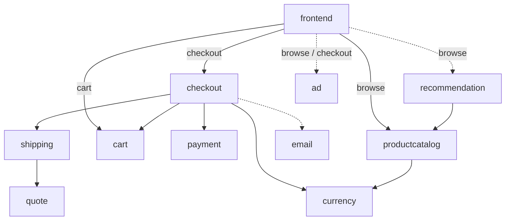

# Initial service graph

The frontend accepts `POST /checkout`, `GET /products`, and `POST /cart`.
Edges shown together are conditional on the user operation, not all called on every request.
Solid edges are critical; dashed edges are optional. Calls execute sequentially.

A quote failure propagates through shipping, checkout and frontend. An email failure
does not fail checkout. Optional calls still consume time in this initial sequential
model; optional means failure-tolerant, not zero-latency. Handler latency includes
its own work and synchronous downstream calls. A failing handler may fail quickly.

Normal work times and operation-specific edges live in `configs/topology.yaml`.
The simulator is an in-process graph, not eleven deployed application processes.
